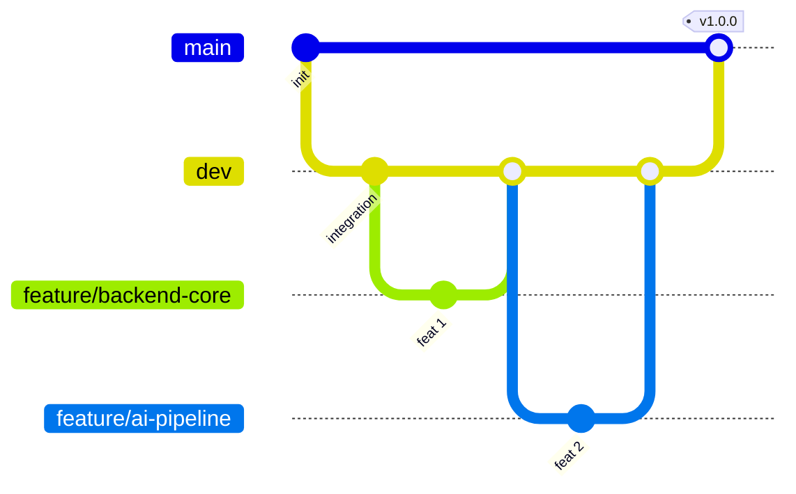

# Development Guide

**Smart Clinical Prescription & Patient Safety Ecosystem**

A short guide for a small hackathon team. It defines the branch hierarchy, the
setup steps, and the exact commands for everyday work so we never break `main`.

---

## 1. Tech Stack

| Layer      | Technology                                   |
| ---------- | -------------------------------------------- |
| Backend    | Python 3.12, FastAPI, SQLAlchemy 2.0, Pydantic |
| Frontend   | React, Tailwind CSS                          |
| Database   | PostgreSQL (Docker) / SQLite (local dev)     |
| AI         | Google Gemini SDK                            |
| Tooling    | Docker, Docker Compose, Git, GitHub CLI (`gh`) |

---

## 2. Repository Layout

```
<repo-root>/
├── backend/                  # FastAPI service (exists today)
│   ├── app/
│   │   ├── database.py
│   │   ├── models.py
│   │   ├── seed_db.py
│   │   └── main.py
│   ├── requirements.txt
│   ├── Dockerfile
│   ├── docker-compose.yml
│   └── .env.example
├── frontend/                 # React + Tailwind (planned)
├── docs/                     # design notes, API contracts (optional)
├── DEVELOPMENT_GUIDE.md      # this file
└── README.md
```

---

## 3. Branch Hierarchy



Three levels, strict direction of flow:

| Branch         | Purpose                                    | Who commits        | Protected |
| -------------- | ------------------------------------------ | ------------------ | --------- |
| `main`         | Production / submission-ready. **Never commit directly.** | Merge from `dev` only, via PR | Yes (strict) |
| `dev`          | Integration. Everything lands here first for end-to-end testing. | Merge from `feature/*` via PR | Yes (soft) |
| `feature/*`    | One branch per feature, created off `dev`. | The feature owner  | No |

**The golden rule:** code flows `feature/*` → `dev` → `main`. Never backwards,
never skipping a level.

### Feature branches for this build

| Branch                   | Owns                                                              |
| ------------------------ | ----------------------------------------------------------------- |
| `feature/backend-core`   | DB models, FastAPI setup, seed scripts, migrations                |
| `feature/ai-pipeline`    | Gemini SDK integration, safety / risk checks                      |
| `feature/doctor-portal`  | Doctor UI, QR scanner, audio/image capture                        |
| `feature/patient-portal` | Patient UI, timeline, medication schedules, Tata 1mg deep link    |

---

## 4. Initial Repository Setup

### 4.1 Prerequisites

- Git (`git --version`)
- Docker Desktop + Compose (`docker compose version`)
- Python 3.12 (`python3.12 --version`)
- Node.js 20+ and npm (for the frontend)
- GitHub CLI, authenticated: `gh auth login` then `gh auth setup-git`

### 4.2 Clone

```bash
git clone https://github.com/vj00000/SmartPrxn.ai.builder.git
cd SmartPrxn.ai.builder
git checkout main
git pull origin main
```

### 4.3 Backend — Docker (recommended)

```bash
cd backend
cp .env.example .env          # then edit .env and add GEMINI_API_KEY
docker compose up -d          # starts PostgreSQL (:5433) + API (:8000)
docker compose run --rm api python -m app.seed_db
open http://localhost:8000/docs
```

### 4.4 Backend — Local (SQLite, no Docker)

```bash
cd backend
python3.12 -m venv .venv
source .venv/bin/activate          # Windows: .venv\Scripts\activate
pip install -r requirements.txt
python -m app.seed_db              # creates smart_rx.db
uvicorn app.main:app --reload
```

### 4.5 Frontend (when it exists)

```bash
cd frontend
npm install
cp .env.example .env.local         # VITE_API_URL=http://localhost:8000
npm run dev
```

### 4.6 Environment files

- `backend/.env` — `DATABASE_URL`, `GEMINI_API_KEY`
- `frontend/.env.local` — `VITE_API_URL`, any public keys

`.env` files are **git-ignored**. Never commit secrets — only `.env.example`.

---

## 5. One-Time Branch Bootstrap

Run **once**, from a machine that already has `main` cloned. Whoever has push
access should do this so everyone else can just `git fetch`.

```bash
# 1. Make sure main is current
git checkout main
git pull origin main

# 2. Create and publish the integration branch
git checkout -b dev
git push -u origin dev

# 3. Create and publish the four feature branches, each off dev
for b in backend-core ai-pipeline doctor-portal patient-portal; do
  git checkout dev
  git pull origin dev
  git checkout -b "feature/$b"
  git push -u origin "feature/$b"
done

# 4. Land back on dev
git checkout dev
```

Verify:

```bash
git branch -a          # main, dev, feature/* should all be listed
git ls-remote --heads origin
```

---

## 6. Daily Workflow

### 6.1 Start work on a feature

Always branch off the **latest** `dev`:

```bash
git checkout dev
git pull origin dev
git checkout feature/ai-pipeline
git merge origin/dev          # bring in whatever landed since you last synced
```

If you are starting a brand-new feature branch:

```bash
git checkout dev && git pull origin dev
git checkout -b feature/<name>
git push -u origin feature/<name>
```

### 6.2 Keep your feature branch in sync with `dev`

Do this **at least once a day**, and always before opening a PR. This is the
single biggest defence against painful merge conflicts — small, frequent syncs
beat one giant merge at the end.

```bash
# Fetch the latest dev, then merge it into your feature branch
git checkout dev
git pull origin dev
git checkout feature/ai-pipeline
git merge origin/dev
```

If you hit conflicts, see Section 9. After merging, push:

```bash
git push origin feature/ai-pipeline
```

> **Alternative (linear history):** some teams prefer rebasing their own
> feature branch onto `dev`. Only rebase branches that **nobody else** is
> working on, and push with `--force-with-lease` (never plain `--force`):
>
> ```bash
> git fetch origin
> git rebase origin/dev
> git push --force-with-lease origin feature/ai-pipeline
> ```

### 6.3 Commit

Small, focused commits with clear messages (see Section 11):

```bash
git add -A
git commit -m "feat(ai): integrate Gemini SDK for prescription risk checks"
```

### 6.4 Push

```bash
git push -u origin feature/ai-pipeline
```

---

## 7. Pull Requests & Code Review

Every merge into `dev` and `main` happens through a **Pull Request (PR)**. No
direct pushes to either protected branch.

### 7.1 Opening a PR

```bash
# after pushing your feature branch
gh pr create \
  --base dev \
  --head feature/ai-pipeline \
  --title "feat(ai): Gemini safety checks" \
  --body "Closes #12. Adds risk scoring + allergy conflict detection."
```

Or open it in the browser: **base = `dev`**, **compare = `feature/...`**.

### 7.2 Reviewer checklist (sanity checks)

A PR may only merge when all of these pass:

- [ ] CI / build is green (`docker compose build`, tests, lint)
- [ ] Backend boots and `/health/db` returns healthy
- [ ] No secrets, tokens, or `.env` files in the diff
- [ ] No direct commits to `main` or `dev` sneaked in
- [ ] New models/columns have a matching seed or migration
- [ ] At least **one** teammate has reviewed and approved (two for `main`)
- [ ] PR description explains **what** and **why**

### 7.3 Local sanity checks before asking for review

```bash
# Backend: build + boot + smoke test
cd backend
docker compose build
docker compose up -d
curl -s http://localhost:8000/health/db      # expect {"status":"healthy",...}
docker compose run --rm api python -m app.seed_db
```

---

## 8. Merging

### 8.1 Feature → `dev`

Merge through a PR. Locally (only if the PR is approved):

```bash
git checkout dev
git pull origin dev
git merge --no-ff feature/ai-pipeline -m "merge: ai-pipeline into dev"
git push origin dev
```

Then delete the merged branch:

```bash
git branch -d feature/ai-pipeline
git push origin --delete feature/ai-pipeline
```

> Prefer **squash merge** (`gh pr merge --squash`) when a feature has many
> noisy commits and you want a single tidy commit on `dev`.

### 8.2 `dev` → `main` (release / submission)

Only when `dev` is verified end-to-end:

```bash
git checkout main
git pull origin main
git merge --no-ff dev -m "release: v1.0.0 hackathon submission"
git tag -a v1.0.0 -m "Hackathon submission v1.0.0"
git push origin main
git push origin --tags
```

---

## 9. Resolving Merge Conflicts

When `git merge origin/dev` reports conflicts:

```bash
git status                        # lists conflicted files
# edit each file, remove the <<<<<<< ======= >>>>>>> markers
git add <resolved-files>
git commit                        # completes the merge
```

Escape hatch — abort and go back to a clean state:

```bash
git merge --abort
```

Rule of thumb: **never** resolve a conflict by deleting the other side's work
blindly. If unsure, ping the author of the conflicting branch.

---

## 10. Branch Protection (GitHub)

Configure in **Settings → Branches → Add branch protection rule**.

**For `main`:**

- Require a pull request before merging
- Require at least **1–2** approvals
- Dismiss stale approvals on new commits
- Require status checks to pass
- Do **not** allow force pushes
- Do **not** allow deletions
- Include administrators (no bypass)

**For `dev`:**

- Require a pull request before merging
- Require at least **1** approval
- Allow admins to bypass (for emergencies)

Via the GitHub CLI (run once by a repo admin):

```bash
gh api -X PUT repos/vj00000/SmartPrxn.ai.builder/branches/main/protection \
  --input - <<'JSON'
{
  "required_status_checks": null,
  "enforce_admins": true,
  "required_pull_request_reviews": {
    "required_approving_review_count": 1,
    "dismiss_stale_reviews": true
  },
  "restrictions": null,
  "allow_force_pushes": false,
  "allow_deletions": false
}
JSON
```

---

## 11. Commit Message Convention

Use **Conventional Commits**: `<type>(<scope>): <subject>`

Types: `feat`, `fix`, `docs`, `refactor`, `test`, `chore`, `style`.

Scopes: `backend`, `db`, `ai`, `doctor`, `patient`, `infra`.

Examples:

```
feat(db): add prescription_medicines relationship
fix(ai): handle Gemini API timeout gracefully
docs(guide): add branch protection steps
chore(infra): publish Postgres on host port 5433
```

Keep the subject in the imperative, under ~72 characters.

---

## 12. Definition of Done

A feature is done when:

1. It works end-to-end against a seeded database.
2. It is merged into `dev` via an approved PR.
3. `dev` builds and boots cleanly (`docker compose up -d` + `/health/db` green).
4. Any new config is documented in `.env.example`.
5. The relevant branch has been deleted after merge.

---

## 13. Quick Reference

```bash
# See everything
git branch -a
git status

# Start a feature off latest dev
git checkout dev && git pull origin dev
git checkout -b feature/<name>

# Sync your feature with dev (do this daily)
git checkout dev && git pull origin dev
git checkout feature/<name> && git merge origin/dev

# Commit + push
git add -A && git commit -m "feat(scope): message"
git push -u origin feature/<name>

# Open a PR into dev
gh pr create --base dev --head feature/<name>

# Merge approved feature into dev
git checkout dev && git pull origin dev
git merge --no-ff feature/<name> && git push origin dev
git branch -d feature/<name> && git push origin --delete feature/<name>

# Release dev into main
git checkout main && git pull origin main
git merge --no-ff dev && git tag -a v1.0.0 -m "release" && git push origin main --tags
```

---

## 14. Roles & Ownership

| Area            | Owner            | Primary branch           |
| --------------- | ---------------- | ------------------------ |
| Backend / DB    | _(assign)_       | `feature/backend-core`   |
| AI pipeline     | _(assign)_       | `feature/ai-pipeline`    |
| Doctor portal   | _(assign)_       | `feature/doctor-portal`  |
| Patient portal  | _(assign)_       | `feature/patient-portal` |

At least one teammate acts as **integration lead**, responsible for keeping
`dev` green and merging into `main`.
